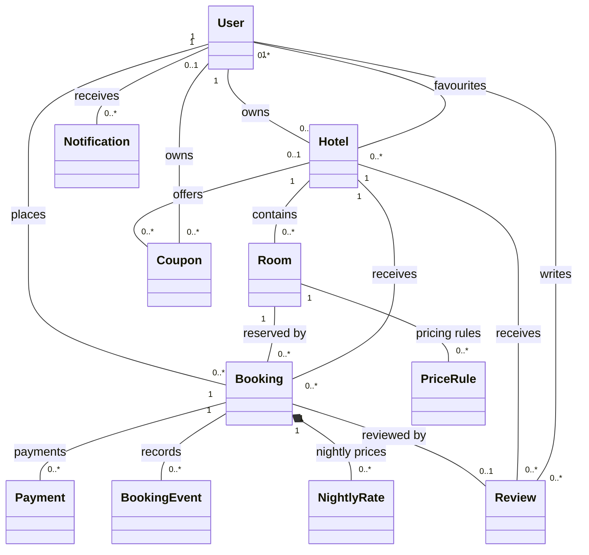

# Reference App — Domain Model (Lab 2)

## 1. Domain classes

The domain classes of the StayHub reference application are located in `src/main/java/com/stayhub/domain/`.

| Class | Responsibility |
|---|---|
| User | Represents guests and hotel owners. |
| Hotel | Stores hotel information and settings. |
| Room | Represents individual hotel rooms. |
| Booking | Represents room reservations. |
| Payment | Stores payment transaction details. |
| BookingEvent | Records changes in a booking's lifecycle. |
| Coupon | Represents promotional discounts. |
| PriceRule | Defines room price adjustments. |
| NightlyRate | Stores the price of an individual night. |
| Review | Represents guest reviews and ratings. |
| Notification | Stores notifications for users. |

The application also contains enumerations such as `Role`, `RoomKind`, `BookingStatus`, `CancellationPolicy`, `PaymentMethod` and `PaymentStatus`.

## 2. Behaviour or only data?

| Class | Behaviour and location of logic |
|---|---|
| User | Mainly data, with helper methods such as `getFirstName()` and `getInitials()`. Account logic is handled by `UserService`. |
| Hotel | Mainly data, with helper methods `getActiveRooms()` and `getLocation()`. Hotel management is handled by `OwnerController`. |
| Room | Mainly getters and setters, with `getDisplayName()`. Availability is handled by `AvailabilityService`. |
| Booking | Contains business behaviour such as `isPaid()`, `isCancellable()`, `isEditable()` and `isConfirmable()`. Booking operations are handled by `BookingService`. |
| Payment | Mainly data, with `getDisplaySource()`. Payment processing is handled by `PaymentService`. |
| BookingEvent | Mainly stores booking history. Events are created by `BookingService`. |
| Coupon | Contains validation logic in `isUsable()` and `isExpired()`. Discounts are calculated by `PricingService`. |
| PriceRule | Contains business logic in `covers()` and `apply()`, used by `PricingService`. |
| NightlyRate | Mainly stores nightly prices, with the helper method `isWeekend()`. Prices are calculated by `PricingService`. |
| Review | Contains `getAverageDetail()` to calculate an average rating. Review submission is handled by `GuestBookingController`. |
| Notification | Mainly data with getters and setters. Notifications are handled by `NotificationService`. |

The reference application is partly anemic because much of its business logic is implemented in services rather than directly in domain classes. However, it is not completely anemic because classes such as `Booking`, `Coupon` and `PriceRule` contain business behaviour.

For example, `Booking.java` at line 143 contains `isCancellable()`, which checks whether a booking has the status `REQUESTED` or `CONFIRMED`. In contrast, `Room.java` does not contain an availability-checking method.

## 3. Its domain model as it actually is

The following domain model is based on the associations and attributes found in the reference application's Java classes.



### Comparison with our domain model

- StayHub uses a single `User` class with different roles, whereas our model separates `Guest` and `HotelOwner`.
- StayHub uses the `RoomKind` enumeration instead of a separate `RoomType` class.
- There are no separate domain classes for `BookingDraft`, `RoomHold` or `SearchCriteria`.
- A booking is initially created with the `REQUESTED` status instead of using a separate booking draft and temporary room hold.
- Cancellation and refund information is stored in `Booking` and `Payment`, whereas our model represents these as separate concepts.
- StayHub supports multiple payment records per booking and configurable cancellation policies.
- StayHub supports both instant booking and owner approval, whereas our model requires immediate confirmation after successful payment.
- Additional concepts such as `Coupon`, `Review`, `Notification`, `BookingEvent` and `PriceRule` are not separately represented in our simplified domain model.

Evidence for these relationships can be found in the `@ManyToOne`, `@OneToMany`, `@OneToOne`, `@ManyToMany` and `@ElementCollection` annotations of the corresponding domain classes.

## 4. Where would "no double booking" live?

In StayHub, the availability logic is implemented in `AvailabilityService.java` through the methods `isFree()` and `isFreeIgnoring()` at lines 34–40.

These methods use the queries `findOverlapping()` and `findOverlappingExcluding()` in `BookingRepository.java`.

The overlap condition at lines 40–41 is:

```sql
and b.checkIn < :checkOut
and b.checkOut > :checkIn
```

This checks whether an existing booking overlaps with the requested stay for the same room. The second query excludes the booking currently being modified.

The rule is checked at two main booking operations:

1. `BookingService.request()` at line 68 checks availability before creating a booking.
2. `BookingService.changeDates()` at line 310 checks availability before modifying booking dates.

The `blocksAvailability()` method in `BookingStatus.java` determines that bookings with the statuses `REQUESTED`, `CONFIRMED` and `CHECKED_IN` block room availability.

The availability logic is therefore shared by both operations rather than implemented directly in the `Room` class.

In our class diagram, this responsibility belongs to the `Room` class through the methods `isAvailable()`, `createHold()` and `reserve()`.

Although StayHub checks for overlapping bookings, the inspected code does not show explicit locking around the availability check and booking update. Therefore, simultaneous booking requests could potentially cause a conflict. This possibility would require further testing.

## Conclusion

The reference application distributes its business logic across domain classes, services and repositories. Our proposed design places more business responsibilities directly in the domain classes.

Our model also represents temporary room holds, cancellations and refunds as separate concepts, making their responsibilities clearer. In particular, assigning availability management to the `Room` class provides a clear location for enforcing the no-double-booking invariant.

However, both designs require a correctly implemented atomic availability check and reservation operation to prevent double bookings under concurrent requests.
