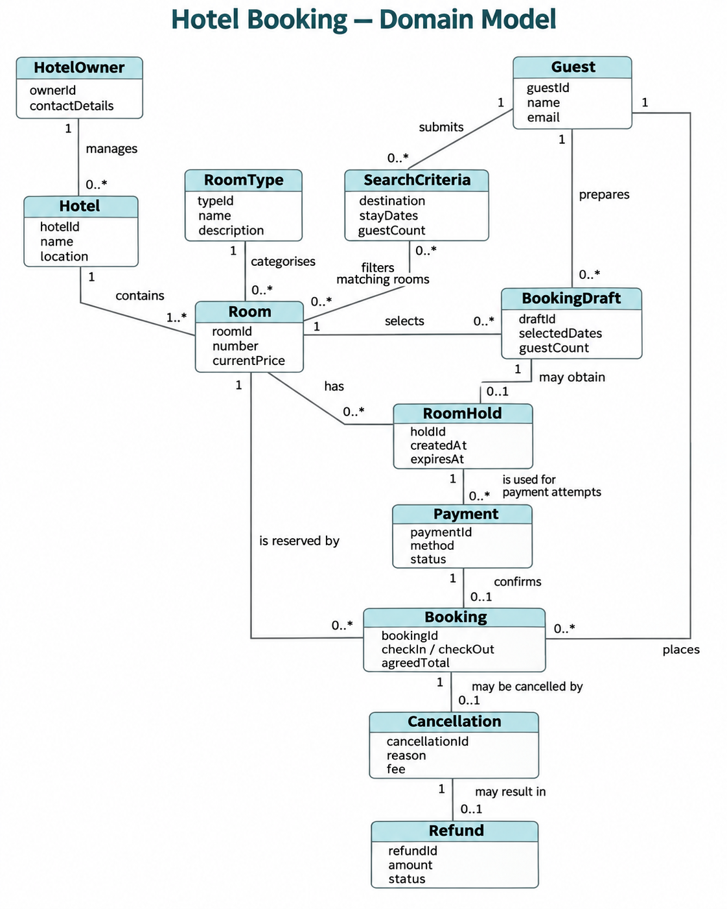

# Domain Model

<!--
Concepts of the hotel booking DOMAIN — not software.
No controllers, services, repositories, database tables or screens.
Save the diagram as docs/design/domain-model.png.
-->

## Concepts and responsibilities

| Concept | Knows | Does | Traces to |
|---|---|---|---|
| **Guest** | Guest identity, name and email | Searches for rooms, prepares drafts, places bookings and requests cancellations | UC-01, UC-02, UC-03; FR-01, FR-02, FR-05, FR-12 |
| **HotelOwner** | Owner identity and contact details | Manages hotels and their room prices; may cancel eligible bookings | UC-03; FR-13, FR-21 |
| **Hotel** | Hotel identity, name and location; which rooms belong to it | Groups the rooms offered by an owner | UC-01; FR-05, FR-13 |
| **RoomType** | Type identity, name and description | Categorises rooms for selection and room-type changes | UC-02; FR-11 |
| **Room** | Room identity, number and current selling price; linked bookings and holds | Determines whether its dates are available and prevents overlapping reservations | UC-01, UC-02; FR-05, FR-07, FR-08, FR-13, FR-26 |
| **SearchCriteria** | Destination, requested stay dates and number of guests | Identifies rooms that match a guest's search | UC-01; FR-05, FR-06 |
| **BookingDraft** | Draft identity, selected dates, guest count and selected room | Keeps the guest's choices before payment; requests a temporary hold and retains details after a failed payment | UC-01; FR-08, FR-10 |
| **RoomHold** | Hold identity, creation time and expiry time; held room | Temporarily reserves a room during payment and expires after 30 minutes if no payment succeeds | UC-01; FR-08, FR-25, FR-26 |
| **Payment** | Payment identity, method and status | Represents a card or PayPal payment attempt and records whether it succeeded | UC-01; FR-09, FR-22 |
| **Booking** | Booking identity, check-in and check-out dates, agreed total; guest and reserved room | Represents the confirmed reservation, keeps its agreed price and can later be cancelled or changed | UC-01, UC-02, UC-03; FR-09, FR-11, FR-12, FR-20, FR-26 |
| **Cancellation** | Cancellation identity, reason and applicable fee | Records a cancellation and determines the relevant cancellation conditions | UC-03; FR-12, FR-19, FR-21 |
| **Refund** | Refund identity, amount and status | Represents money returned to the guest after an eligible cancellation | UC-03; FR-19, FR-27 |

## Associations

| From | To | Multiplicity | Meaning |
|---|---|---|---|
| HotelOwner | Hotel | `HotelOwner (1) — Hotel (0..*)` | An owner manages zero or more hotels; each hotel has one owner. |
| Hotel | Room | `Hotel (1) — Room (1..*)` | A hotel contains one or more rooms; each room belongs to one hotel. |
| RoomType | Room | `RoomType (1) — Room (0..*)` | A room has one type; a type may describe many rooms. |
| Guest | SearchCriteria | `Guest (1) — SearchCriteria (0..*)` | A guest may submit multiple searches; each search belongs to one guest. |
| SearchCriteria | Room | `SearchCriteria (0..*) — Room (0..*)` | Search criteria can match multiple rooms, and a room can match multiple searches. |
| Guest | BookingDraft | `Guest (1) — BookingDraft (0..*)` | A guest may prepare several booking drafts. |
| Room | BookingDraft | `Room (1) — BookingDraft (0..*)` | A room can be selected in multiple booking drafts; each draft selects one room. |
| BookingDraft | RoomHold | `BookingDraft (1) — RoomHold (0..1)` | A draft may obtain one room hold; each hold belongs to one draft. |
| Room | RoomHold | `Room (1) — RoomHold (0..*)` | A room may have holds over time; each hold concerns one room. |
| RoomHold | Payment | `RoomHold (1) — Payment (0..*)` | A valid hold can be used for multiple payment attempts; each attempt belongs to one hold. |
| Payment | Booking | `Payment (1) — Booking (0..1)` | Every confirmed booking requires one successful initial payment. A payment attempt may exist without a confirmed booking. |
| Guest | Booking | `Guest (1) — Booking (0..*)` | A guest can place multiple bookings; each booking belongs to one guest. |
| Room | Booking | `Room (1) — Booking (0..*)` | A room may be booked for different stays; each booking reserves one room. |
| Booking | Cancellation | `Booking (1) — Cancellation (0..1)` | A booking may have one cancellation; each cancellation refers to one booking. |
| Cancellation | Refund | `Cancellation (1) — Refund (0..1)` | A cancellation may lead to one refund; each refund refers to one cancellation. |

## Attributes

| Concept | Attributes |
|---|---|
| Guest | `guestId`, `name`, `email` |
| HotelOwner | `ownerId`, `contactDetails` |
| Hotel | `hotelId`, `name`, `location` |
| RoomType | `typeId`, `name`, `description` |
| Room | `roomId`, `number`, `currentPrice` |
| SearchCriteria | `destination`, `stayDates`, `guestCount` |
| BookingDraft | `draftId`, `selectedDates`, `guestCount` |
| RoomHold | `holdId`, `createdAt`, `expiresAt` |
| Payment | `paymentId`, `method`, `status` |
| Booking | `bookingId`, `checkIn`, `checkOut`, `agreedTotal` |
| Cancellation | `cancellationId`, `reason`, `fee` |
| Refund | `refundId`, `amount`, `status` |

## Invariants

<!-- Rules that must always hold, and which concept is responsible for each. -->

| Rule | Responsible concept |
|---|---|
| Every room belongs to exactly one hotel and has one room type. | Room |
| A guest's requested check-out date must be after their check-in date. | SearchCriteria / BookingDraft |
| A search or draft must request at least one guest. | SearchCriteria / BookingDraft |
| A booking must have a check-out date after its check-in date. | Booking |
| The same room cannot have two confirmed bookings with overlapping stay dates. | Room |
| The room's availability check must also respect any active hold for overlapping dates. | Room |
| A room hold starts when payment is initiated and expires 30 minutes after its creation unless successfully consumed. | RoomHold |
| An expired hold cannot be used to confirm a new booking; if payment has not succeeded, the room is released. | RoomHold |
| A confirmed booking is created only after a successful payment while its hold is valid; no hotel-owner approval is needed. | Booking |
| A failed payment must not produce a confirmed booking. | Booking |
| A payment method for a booking is card or PayPal, not payment at the hotel. | Payment |
| After a payment failure, entered booking details are available for retry for up to 30 minutes; retaining them does not extend an expired hold. | BookingDraft |
| Once a booking is confirmed, later changes to the room's current price must not change its agreed total. | Booking |
| A guest cancellation at least 48 hours before arrival is free; a later cancellation incurs the first night's charge. | Cancellation |
| An owner may cancel directly only at least 14 days before arrival and with a valid reason; otherwise support must be contacted. | Cancellation |
| An eligible owner cancellation gives the guest a full refund. | Refund |
| A recorded cancellation refers to one booking and may result in at most one refund under this simplified model. | Cancellation / Refund |

## Peer Review

We presented our domain model and sequence diagram to our partner team during Lab 2. No issues or suggestions for improvement were raised by the reviewing team.

While developing the class diagram, we noticed that some of the multiplicities in the domain model could be improved. We decided to refine these relationships in the class diagram:

- A room can have multiple booking drafts instead of being limited to one.
- A booking draft can exist without an active room hold.
- A confirmed booking must be associated with a successful payment.
- Search criteria can match multiple rooms.

These refinements were identified during the detailed design phase rather than during the peer review. The original sequence diagram was retained and the original domain model diagram was changed to align with the class diagram.
