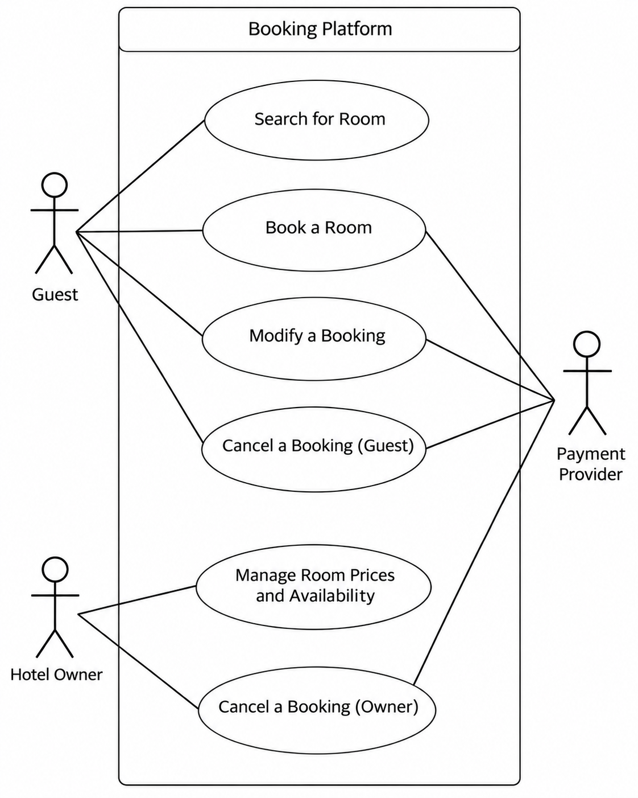

# Use Cases — Hotel Booking Platform (corrected)

<!--
Describe the three selected complex use cases. Use → for actor actions and ← for system responses.
Each use case contains the main success scenario and at least two alternate flows.
Use case numbering and requirement references follow requirements-corrected.md.
-->

## UC-01 — Book a Room

| Field | Description |
|---|---|
| Related requirements | **Main scenario:** FR-05, FR-06, FR-07, FR-08, FR-09, FR-14, FR-20, FR-22, FR-23. **Alternates:** FR-10, FR-18. **Registration prerequisites:** FR-01, FR-02, FR-03, FR-04. |
| Related decisions | D-01, D-02, D-03, D-04, D-05, D-06, D-07, D-09, D-16, D-17, D-21, D-22, D-23, D-26, D-27 |
| Initiating actor | Guest |
| Actor's goal | Find an available room and complete a guaranteed, paid booking. |
| Participating actors | Payment Provider (card or PayPal) |
| Preconditions | The guest has registered and the booking platform is available. Registration requires first name, last name and email; phone is optional. Birthday collection is subject to separate explicit consent, not a mandatory booking step. |
| Success postconditions | A booking is confirmed immediately after payment succeeds while the room hold is valid; the agreed booking price is recorded and the guest is informed. No owner approval is needed. |
| Failure postconditions | No booking is created or confirmed if payment does not succeed or the hold expires. A failed attempt is not presented as a confirmed booking. |

**Main success scenario**

1. → Guest searches for accommodation by destination, check-in/check-out dates and number of guests; the guest may also select the wheelchair-accessibility filter.
2. ← System displays matching **available** rooms, respecting any accessibility filter, with prices that include applicable taxes.
3. → Guest selects a room.
4. ← System displays the room details, stay dates, availability, conditions and total tax-inclusive price.
5. → Guest confirms the booking details, may apply a promotional code, and may request an invoice.
6. ← System validates any promotional code, shows the final payable total including taxes, and asks for a billing address **only if an invoice was requested**. Nationality and copies of ID documents are not required.
7. → Guest selects **card or PayPal** and presses **Pay**.
8. ← System checks the room is still available and establishes an exclusive **30-minute temporary hold**. This hold is **not** a confirmed booking; competing requests are prioritized by order of receipt.
9. → Guest completes payment through the Payment Provider.
10. ← Payment Provider reports successful payment while the hold remains valid.
11. ← System immediately creates and confirms the booking, recording the price agreed at confirmation; no Hotel Owner approval is required.
12. ← System displays the confirmed booking and sends the guest confirmation information.

**Alternate flow A — No matching rooms (branches at step 2)**

- a. ← System finds no available rooms matching the criteria and filter.
- b. ← System informs the guest that no rooms match.
- c. → Guest may change search criteria and try again; no booking is created.

**Alternate flow B — Room unavailable when payment starts (branches at step 8)**

- a. ← System finds that the room is already booked or reserved by an earlier valid hold/request for overlapping dates.
- b. ← System refuses to create a second hold and informs the guest that the selected room is unavailable.
- c. → Guest can return to the search; no booking is created.

**Alternate flow C — Invalid or expired promotional code (branches at step 6)**

- a. ← System rejects the promotional code and does not apply its discount.
- b. ← System shows the price without that discount and explains why the code cannot be used.
- c. → Guest removes the code or selects another valid code, then continues from step 7.

**Alternate flow D — Payment failure (branches at step 10)**

- a. ← Payment Provider reports failure.
- b. ← System informs the guest that payment failed and that **no booking is confirmed**.
- c. ← System retains the entered booking information for **30 minutes after the payment failure**, so it can be reused for a retry. This does **not** extend the room hold created at step 8.
- d. → Guest may retry with card or PayPal. A retry can complete the booking only if a valid hold still exists and payment succeeds before that hold expires; otherwise the guest must seek a new available hold.

**Alternate flow E — Room hold expires (branches after step 8, before confirmation)**

- a. ← The 30-minute hold expires without successful payment.
- b. ← System releases the room for other guests and informs the guest that the booking was not completed.
- c. → Guest can search again and restart the booking process; any retained form information does not preserve an expired hold.

**Alternate flow F — Processing unavailable or payment success cannot be verified (branches at steps 10–11)**

- a. ← The platform cannot finish processing or verify the payment result.
- b. ← System does not announce a successful booking without a verified successful payment and a valid hold.
- c. ← System informs the guest that the booking has not been confirmed and that the completion status needs checking before another attempt.

**Registration and consent scope:** FR-01–FR-04 are prerequisites or related registration behavior rather than extra compulsory booking steps. Birthday and marketing consent must not be assumed from registration or a booking; marketing consent is separately covered by FR-24.

---

## UC-02 — Modify a Booking

| Field | Description |
|---|---|
| Related requirements | FR-07, FR-11, FR-20 |
| Related decisions | D-03, D-12, D-13, D-17 |
| Initiating actor | Guest |
| Actor's goal | Change the dates or room type of an existing booking when permitted. |
| Participating actors | Payment Provider, **if** an additional payment or payment adjustment is required |
| Preconditions | Guest is logged in and owns an existing confirmed booking; the requested modification is made **at least 48 hours before check-in**. |
| Success postconditions | Permitted changes are saved, based on availability and the **current price** for the changed booking; the guest receives confirmation. |
| Failure postconditions | If a change is unavailable, too late, unconfirmed, or cannot be completed, the original booking remains unchanged at its existing agreed price. |

**Main success scenario — Change dates or room type**

1. → Guest opens a confirmed booking they own.
2. ← System displays booking details, current agreed price, and available modification options.
3. → Guest chooses **Modify a Booking**.
4. ← System offers permitted changes to **stay dates or room type**.
5. → Guest enters the requested new dates or room type.
6. ← System checks that the request is made **at least 48 hours before check-in**, verifies availability for the requested stay and applies the booking-change rules.
7. ← System shows the revised details and **current price** for the modified booking, including applicable taxes and any payment difference.
8. → Guest reviews the changes and accepts the revised price.
9. ← If a payment adjustment is needed, it is handled through the Payment Provider; once the change can be completed, the system updates the booking and its newly agreed price.
10. ← System informs the guest that the booking has been modified.

**Alternate flow A — New dates or room type are unavailable (branches at step 6)**

- a. ← System determines that the requested accommodation is not available.
- b. ← System explains that the requested change cannot be made.
- c. ← The original booking, dates, room type and agreed price remain unchanged.

**Alternate flow B — Fewer than 48 hours remain before check-in (branches at step 6)**

- a. ← System determines that the request is too late under the modification rule.
- b. ← System rejects the date/room-type change and explains the deadline.
- c. ← The existing confirmed booking remains unchanged.

**Alternate flow C — Guest declines the new price or abandons the change (branches at step 8)**

- a. → Guest does not confirm the proposed modification.
- b. ← System discards the unconfirmed changes.
- c. ← The original booking and its agreed price remain unchanged.

**Alternate flow D — Payment adjustment cannot be completed (branches at step 9, when applicable)**

- a. ← Payment Provider reports that the required payment adjustment has not succeeded.
- b. ← System informs the guest that the modification was not completed.
- c. ← The original confirmed booking remains unchanged.

**Decision to verify:** D-12/D-13 also mention changes involving the **payment method** under the same applicable booking-change rules. The exact steps for changing only the payment method were not specified, so this scenario does not invent a provider workflow. The earlier claim that guests may change the **number of guests** was not confirmed by the professor and is excluded until checked against stakeholder notes. A later owner price change alone does **not** change an existing booking's agreed price (FR-20); the current price applies when the guest makes a permitted booking modification (FR-11).

---

## UC-03 — Cancel a Booking

| Field | Description |
|---|---|
| Related requirements | FR-12, FR-19, FR-21 |
| Related decisions | D-08, D-11, D-20 |
| Initiating actor | Guest (main flow); Hotel Owner (alternate flow D) |
| Actor's goal | Cancel an existing confirmed booking according to the applicable rules. |
| Participating actors | Payment Provider for refunds; Hotel Owner for alternate D |
| Preconditions | Guest is logged in and owns the booking, or an authorized Hotel Owner manages the relevant hotel. The booking is confirmed. |
| Success postconditions | Booking is cancelled, the applicable refund is initiated, and the guest is informed. Owner-initiated direct cancellation additionally requires a valid reason and at least 14 days before arrival. |
| Failure postconditions | If cancellation is not confirmed or is not permitted, the booking stays unchanged. Any refund-processing issue is recorded and communicated without falsely claiming the refund is complete. |

**Main success scenario — Guest cancellation at least 48 hours before arrival**

1. → Guest opens their confirmed booking.
2. ← System displays the details and cancellation option.
3. → Guest requests cancellation.
4. ← System calculates the time until check-in and displays the applicable policy and **full refund** (at least 48 hours remain before arrival).
5. → Guest confirms the cancellation.
6. ← System marks the booking as cancelled and releases the booked dates from the room's schedule.
7. ← System initiates the **full refund** through the Payment Provider.
8. ← System informs the guest that the booking is cancelled and communicates the refund status.

**Alternate flow A — Guest cancels less than 48 hours before arrival (branches at step 4)**

- a. ← System finds that fewer than 48 hours remain before arrival.
- b. ← System displays the **first-night charge** and the remaining refundable amount, if any.
- c. → Guest may confirm cancellation at step 5.
- d. ← If confirmed, system cancels the booking, retains the first-night charge and initiates refund of any remainder, then informs the guest.

**Alternate flow B — Refund processing fails (branches at step 7)**

- a. ← Payment Provider cannot process the refund immediately.
- b. ← System records the refund-processing problem without stating that the refund succeeded.
- c. ← System informs the guest that cancellation was recorded but refund processing is still unresolved.

**Alternate flow C — Guest does not confirm (branches at step 5)**

- a. → Guest declines or abandons cancellation.
- b. ← System does not cancel the booking or initiate a refund.
- c. ← The original booking remains confirmed.

**Alternate flow D — Hotel Owner cancels (branches at step 1: owner initiates instead of guest)**

- a. → Hotel Owner opens a confirmed booking for a hotel they manage and requests cancellation.
- b. ← System checks time until arrival and requires a valid cancellation reason.
- c. **If at least 14 days remain and a valid reason is provided:** → Owner confirms; ← system **directly cancels** the booking, records the reason, initiates a **full refund**, and **automatically informs the guest** (D-11). No owner-approval queue or pending approval is involved.
- d. **If fewer than 14 days remain:** ← system blocks direct owner cancellation and directs the owner to **contact support**. Support handling beyond that point is not specified in the current decisions.
- e. **If no valid reason is provided:** ← system does not complete direct cancellation and asks for a valid reason.

---

